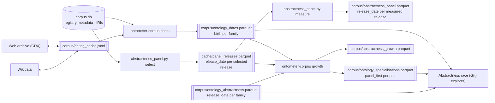

# Dates

This page explains where every date in the corpus tables comes from, which sources bound
it, how lookups are cached so a rebuild gives the same answer, and how the dates place
ontologies and links in time. After reading it you can refresh the dates and know which
ones a rebuild without network access can and cannot reproduce.

A corpus is a single capture, so time has to be added afterwards. Abstractness over releases
and the network over time, G(t), use three kinds of date:

- a **release date** for each fetched file, taken from its registry;
- a **first-evidence date** (`birth`) for each release family, the earliest date any source
  attests to it;
- an **arrival date** for each specialisation pair, when one ontology started specialising
  another.



## Release dates

`ontometer_corpus.versions.release_date` reads the date a registry records for one release
from the row's `source_registry_metadata`: `released` (OntoPortal submissions), else `issued`
(LOV versions), else `creationDate`. It is derived when needed and not stored as a column of
`corpus.db`. Release dates order the releases of a family (`release_order`, with the submission
number as tie-breaker), so they decide:

- the family's representative release, the newest one, whose date is `release_date` in
  `ontology_abstractness.parquet`;
- the releases of the release panel: `ontometer-corpus panel select` lists them, with their
  `release_date`, in `$ONTOMETER_STORE/cache/panel_releases.parquet`, and `measure` carries the
  date into `corpus/abstractness_panel.parquet`. Releases without a registry date are left out of
  the panel.

A registry date is when *that registry* took the file, not when the ontology was published.

## First-evidence dates

No source records when an ontology was born. Each of the following is an upper bound on that
date, and `ontometer-corpus dates` keeps the earliest for each release family (functions in
`ontometer_corpus.dating`):

| Column | Source | Rule |
|---|---|---|
| `d_registry` | registry metadata in `corpus.db` | Earliest release date among the family's rows and every corpus row with the same ontology IRI, from any registry. IRIs are matched without scheme, case, a trailing `#`/`/` or a file extension (`iri_match_key`). An IRI dedup marked `shared_iri` links nothing. |
| `d_archive` | Internet Archive CDX API | Earliest first capture over the family's IRIs (`archive_candidates`), plus the `.owl` download for OBO PURLs. IRIs without a host are skipped. Ontohub families without an IRI use their repository page. |
| `d_wikidata` | Wikidata SPARQL | Earliest inception (P571) or publication date (P577) of the item Open Knowledge Graphs links to (an `okg:Q…` fetch identifier, or `wikidataId` in the metadata). |

Every date is truncated to `YYYY-MM-DD` and kept only between `1995-01-01` and `as_of`, the
latest retrieval date in `corpus.db` (the capture date). The upper limit comes from the corpus,
not from the day the script runs, so the same corpus and cache always give the same table.

`corpus/ontology_dates.parquet` has one row per family in the entity network:

| Column | Meaning |
|---|---|
| `family`, `registry`, `ontology_iri` | the release family and its representative's registry and IRI |
| `d_registry`, `d_archive`, `d_wikidata` | the three bounds; missing when a source has none |
| `birth` | the earliest of the three: the first-evidence date |
| `birth_source` | `registry`, `archive` or `wikidata`, whichever set `birth` |
| `n_sources` | how many of the three are present |
| `as_of` | the capture date (the same on every row) |
| `lookups_complete` | false where a network lookup was missing from the cache (see below) |

## The lookup cache

`corpus/dating_cache.jsonl` records every network answer, one JSON object per line:
`{"k": "cdx:<url>", "v": "YYYY-MM-DD"}` or `{"k": "wd:<QID>", "v": "<date>"}`. A null `v`
is a completed lookup that found nothing. A key missing from the file is a lookup that never
completed. The file is append-only and tracked in git, because the archive and Wikidata can
change their answers: the cache is what makes the dates reproducible.

| Run | Network | Missing lookups |
|---|---|---|
| `ontometer-corpus dates` | Wikidata in batches, then the archive, starting with families that have no registry date (`--workers`, `--delay`) | Fetched and cached. If the archive stops answering (three URLs in a row), the run writes nothing and exits 75; rerun to resume. |
| `--offline` | none | The run fails, naming them. |
| `--offline --allow-uncached` | none | Counted as no evidence, and the family's `lookups_complete` is false. `ontometer-corpus rebuild --local` uses this. |

The archive's 4xx answers are cached as "no capture". Throttling (408, 425, 429, 503), server
errors and its "temporarily offline" page are retried and never cached.

## Dates in G(t)

`ontometer-corpus growth` places the specialisation pairs in time and writes them to
`corpus/ontology_specialisations.parquet`. `panel_first` is the date of the child family's
first panel release that asserts the pair; it is missing when the child is not in the
release panel. The rest is computed from the three tracked tables whenever they are loaded
(`ontometer_corpus.growth_network.assemble`, `dating.time_pairs`), and is not stored:

- **Arrival** of a pair: `panel_first` where known, otherwise the child's `birth`. The
  fallback assumes the pair dates from the child's first release. A pair never arrives
  before its parent.
- **Bounded birth** of an ontology: the earlier of its `birth` and the first *observed*
  specialisation of one of its classes (`dating.bound_births`). A specialisation is observed
  at its `panel_first` or at the child's representative `release_date`. An assumed arrival
  never moves a birth, and the bound is not chained. An ontology with no `birth` but a dated
  observation becomes dated.

The growth measures are computed for both births and stored in
`corpus/abstractness_growth.parquet` (`birth_bounded`, `birth_first_evidence`). The
[abstractness race](growth.md) (the G(t) explorer) shows each ontology from its bounded birth and leaves out the
ones with no date at all.

Registries and the web archive start later than the oldest ontologies, so those get late
dates and appear already specialised.

## Refreshing the dates

```bash
ontometer-corpus dates                 # query new lookups, write the table
ontometer-corpus dates --offline       # rebuild from the cache only
ontometer-corpus growth --out <dir>    # re-time the pairs
properdocs build                       # regenerate the abstractness race explorer
```

`ontometer-corpus rebuild --from dates --out <dir>` runs dates, growth and the G(t) export in order,
and resumes after an interrupted archive run.

## What to read next

- [Abstractness](abstractness.md#over-time-the-ontology-dag-gt): what is
  measured on the dated network.
- [Abstractness race](growth.md): the dated network, drawn.
