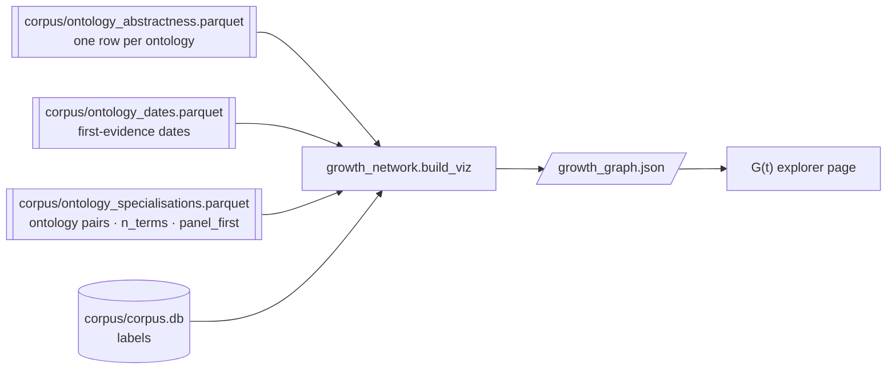

# The abstractness race

This page is the G(t) explorer itself, with how to read it, when an ontology or a link appears,
and where its data comes from. After reading it you can read the disk, and rebuild the
explorer after the tables behind it change.

The specialisation network of the corpus ontologies, replayed over time in the Poincaré disk.
Each dot is an ontology. A link means one ontology *specialises* another: it declares classes
under the other's classes, that is, it builds on it. Every ontology that builds on another pulls
it toward the centre, so the ontologies race toward the centre as the corpus grows. Being closer
to the centre is what becoming more abstract means in the network sense (see
[Abstractness](abstractness.md#over-time-the-ontology-dag-gt)).

[Open the explorer on its own page](g_t/index.html){ .md-button }

<iframe src="../g_t/?embed" title="The abstractness race" loading="lazy"
        style="width: 100%; height: 1200px; border: 1px solid var(--md-default-fg-color--lightest); border-radius: 4px;"></iframe>

## Reading it

- **Angle** is fixed for the whole replay. Each ontology sits inside the wedge of its
  *primary parent*, the ontology whose classes it specialises most (cycles are cut). Wedges are
  proportional to subtree size, and top-level groups follow the reuse communities of the
  corpus. An ontology never moves sideways.
- **Distance from the centre** is hyperbolic: `r = r_max · (1 − log(1 + s) / log n)`, drawn at
  disk radius `tanh(r / 2)`. `s` counts the ontologies that specialise it, directly or
  transitively, by the year shown, and `n` is one more than the largest `s` at capture, so the
  most specialised ontology ends at the centre. `n` is fixed, so an ontology only ever moves
  inward, and it moves exactly when it gains a specialiser. Dashed rings mark `s` = 1, 10 and 100.
- **Filled** dots are built on by at least one ontology; **hollow** dots are leaves. Colour
  is the registry family.
- **Links** are drawn as Poincaré geodesics: circle arcs orthogonal to the rim.
- The **leaderboard** ranks the five ontologies with the largest `s` at the year
  shown: the ones closest to the centre.
- The **chart** shows the share of ontologies built on by another ontology, for the whole network
  at each year and for three birth cohorts, with a cursor at the year shown.

Play replays the years. Hover over a dot for its registry, first evidence, first specialisation
and specialisers. Click one to highlight what it specialises and what specialises it. The
search box finds an ontology by label, and a toggle restricts the view to ontologies with a
hierarchy.

`g_t/index.html?video` renders a fixed 1080×1350 frame for recordings: the disk, the year, the
leaderboard and a closing summary, without controls. `window.gt.step(t)` advances it one eased
frame to year `t`, so a recording does not depend on the machine's speed; `?theme=dark` switches
the scheme. `?embed`, as on this page, leaves out the explorer's own title and notes.

## When things appear

An ontology appears at its *bounded birth*: its first-evidence date (the earliest of its
registry release dates, the web archive's first capture of its IRI and its Wikidata inception
date), never later than the first observed specialisation of its classes. A link appears at the
first release of the specialiser that asserts it when that ontology's release history is in
the release panel, and otherwise at the specialiser's first evidence; never before its parent.
Ontologies with no date at all are left out, and the page says how many. [Dates](dates.md)
describes the sources and rules.

Registries and the web archive start later than the oldest ontologies, so those are dated late
and appear already specialised: their leaf phase is not observed.

## Where the data comes from

The page reads one file, `growth_graph.json`, which the documentation build generates from three
small tracked tables and `corpus.db`. No object store is needed to rebuild it.



| Table | Written by | Needs |
|---|---|---|
| `ontology_abstractness.parquet` | `ontometer-corpus abstractness` | the entity network (object store) |
| `ontology_dates.parquet` | `ontometer-corpus dates` | `corpus.db`, the entity network, the web archive and Wikidata (lookups cached) |
| `ontology_specialisations.parquet` | `ontometer-corpus growth` | the entity network and the release panel's sidecars |

Refreshing the view after any of them changes:

```bash
uv sync --extra docs
uv run properdocs build                    # regenerates growth_graph.json from data/
ontometer-corpus growth-viz --out <dir>    # the same file, for use elsewhere
```

The page itself is `docs/g_t/index.html`, a single self-contained file. It fetches
`growth_graph.json` from its own folder, so to open a copy outside this site, serve that folder
over HTTP (`python -m http.server`); browsers refuse to fetch files for a page opened from disk.

The payload and the layout are defined in
[`ontometer_corpus.growth_network`](reference/growth_network.md) and
[`ontometer_corpus.network.hyperbolic`](reference/network/hyperbolic.md).

## What to read next

- [Abstractness](abstractness.md#drawing-gt): why the layout is constructed
  the way it is.
- [Dates](dates.md#dates-in-gt): how arrivals and bounded births are placed in
  time.
