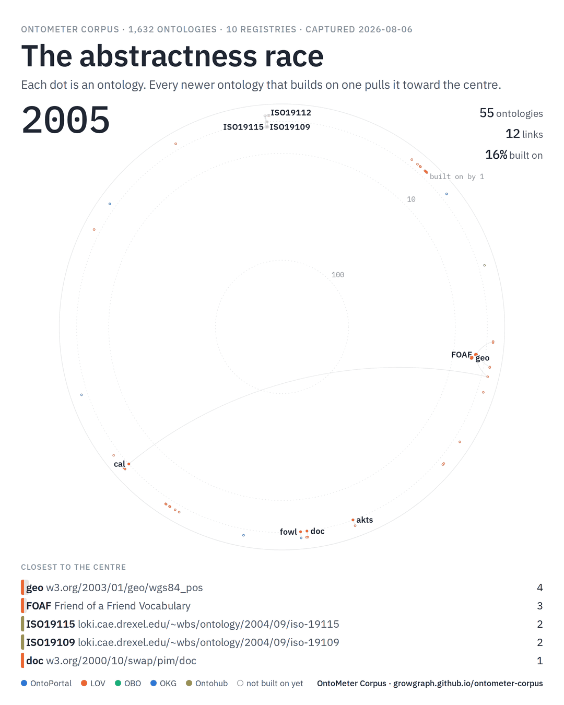

# OntoMeter Corpus

A corpus of public ontologies, processed into tables: what each ontology is, how ontologies
depend on one another, and how abstract and how reused they are. The ontologies come from ten
public registries (six OntoPortal Alliance instances, OBO Foundry, Ontohub, Open Knowledge
Graphs and LOV), parsed and deduplicated across registries and versions.

## Why a corpus of ontologies

Reuse is the premise of the semantic web: a new ontology should build on the vocabularies that
already exist rather than define its terms again. Whether that happens, and around which
ontologies, is hard to see from any one place.

- **The population is scattered.** Ontologies sit in several registries that overlap, mirror
  one another and keep many versions of the same file, so counting from a single registry
  over-counts some ontologies and misses others.
- **Reuse takes many forms.** An ontology can `owl:import` another, use a few of its terms
  without importing it, or declare its own classes under another's classes. Each form says
  something different about dependence.
- **Abstractness is relative.** Whether a term is general or specific, a class or an instance,
  depends on how the other ontologies use it, which only a population shows.

The corpus answers these with one population: each ontology counted once, the dependency
network between ontologies with every edge traceable to the triples behind it, and measures of
generality and reuse for terms and for ontologies. With it you can ask which ontologies the
rest build on, how concentrated reuse is, how one ontology compares with all the others, and how
the network grew over time.

<figure markdown>
  
  <figcaption markdown>
  **The abstractness race.** Each dot is an ontology; a link means one ontology declares
  classes under another's. As the corpus grows, the ontologies others build on are pulled
  toward the centre. [Explore it year by year](growth.md).
  </figcaption>
</figure>

## What the repository holds

- **The tables**, in `data/`, versioned in git and released as `corpus-YYYY-MM` tags. They are
  plain Parquet, SQLite, JSON Lines and TSV, so reading them needs no package.
- **The `ontometer-corpus` package**, which loads the tables, derives them from the raw
  ontology files, and regenerates the figures and numbers of the paper that describes the
  corpus.

The raw ontology files are not in the repository; they live in an [object store](store.md).

## Where to start

The pages follow the order in which a new reader needs them:

1. [Install and use](getting_started.md): install the package and load the network in a few lines.
2. [The tables](tables.md): what each file holds and how the files join.
3. **Measures**: what the columns mean. [Abstractness](abstractness.md) defines generality and
   class-likeness, [Dates](dates.md) places ontologies in time, and the
   [abstractness race](growth.md) shows both at once.
4. **Pipeline**: how the tables are made, from the [overview](overview.md) of every step to
   [rebuilding](rebuild.md) them and what a rebuild reproduces.
5. [The paper](paper.md): regenerate every figure and number of the paper from the tables.

## I want to...

| I want to... | Read |
|---|---|
| Install the package and run a command | [Install and use](getting_started.md) |
| Know what each table holds and how the tables join | [The tables](tables.md) |
| Measure how general or how class-like a term is | [Abstractness](abstractness.md) |
| Know where the dates come from | [Dates](dates.md) |
| Watch the network of ontologies grow | [Abstractness race](growth.md) |
| See which command writes which table | [Overview](overview.md) |
| Fetch, parse and deduplicate ontologies | [Fetch, parse, dedup](pipeline.md) |
| Get, check, extend or publish the raw files | [Object store](store.md) |
| Know what a node and an edge of the dependency network mean | [Dependency network](network.md) |
| Rebuild every table, and know what a rebuild reproduces | [Rebuilding](rebuild.md) |
| Regenerate the paper's figures and numbers | [The paper](paper.md) |
| Call the code from Python | [API reference](reference/index.md) |
