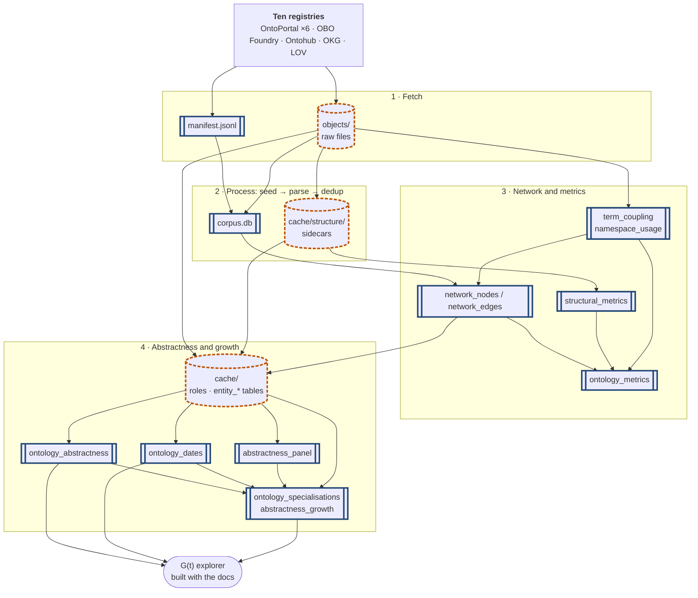

# Overview

The tables are derived, not curated by hand: a fixed sequence of steps turns registry downloads
into every file in `data/`, so any number can be traced back to the files and rules behind it.

The pipeline fetches ontologies from ten registries, parses and deduplicates them, builds the
dependency network between them, and measures the abstractness of their terms and how the
network of ontologies grows. This page is the map: which command writes which table, where the
data lives, and what is tracked. [Rebuilding](rebuild.md) gives the commands that regenerate
the tables and says what a rebuild does and does not reproduce.

## The pipeline end to end



**Solid blue outlines are tracked in git, in the corpus repository (the corpus directory);
dashed orange outlines are not.** Those live in the
object store (`$ONTOMETER_STORE`), which is too large for a repository.

| Stage | Command | Reads | Writes | Object store |
|---|---|---|---|---|
| 1 · Fetch | `ontometer-corpus fetch` | registry APIs | `objects/`, `manifest.jsonl`, `fetch_failures.log` | yes |
| 2 · Seed | `ontometer-corpus process --phases seed` | `manifest.jsonl` | `corpus.db` | no |
| 2 · Parse | `ontometer-corpus process --phases parse` | `objects/`, `corpus.db` | `corpus.db`, `cache/structure/` | yes |
| 2 · Dedup | `ontometer-corpus process --phases dedup` | `corpus.db`, `cache/structure/` | `corpus.db`, `dedup_exclusions.log` | for Pass D |
| 3 · Term coupling | `ontometer-corpus term-coupling` | `corpus.db`, `objects/` | `term_coupling.parquet`, `namespace_usage.parquet` | yes |
| 3 · Network | `ontometer-corpus network` | `corpus.db`, `cache/structure/`, `namespace_usage.parquet` | `network_nodes.parquet`, `network_edges.parquet` | yes |
| 3 · Hierarchy metrics | `ontometer-corpus structural-metrics` | `corpus.db`, `cache/structure/` | `structural_metrics.parquet` | yes |
| 3 · Metric table | `ontometer-corpus ontology-metrics` | `corpus.db`, stage 3 tables | `ontology_metrics.parquet` | no |
| 4 · Roles | `ontometer-corpus entity-roles` | `corpus.db`, `objects/` | `cache/roles/`, `cache/roles_summary.parquet` | yes |
| 4 · Term network | `ontometer-corpus entity-network` | `corpus.db`, network nodes, `cache/structure/`, `cache/roles/` | `cache/entity_{ontologies,terms,edges,docs,labels}.parquet` | yes |
| 4 · Abstractness | `ontometer-corpus abstractness` | `cache/entity_*` | `cache/entity_abstractness.parquet`, `ontology_abstractness.parquet` | yes |
| 4 · Release panel | `ontometer-corpus panel select`, then `measure` | `corpus.db`, `cache/entity_*`, `cache/structure/`, `cache/roles/` | `cache/panel_releases.parquet`, `abstractness_panel.parquet` | yes |
| 4 · Dates | `ontometer-corpus dates` | `corpus.db`, `cache/entity_ontologies.parquet`, web archive, Wikidata | `ontology_dates.parquet`, `dating_cache.jsonl` | yes |
| 4 · Growth | `ontometer-corpus growth --out <dir>` | the three tables above, `cache/entity_*`, panel sidecars | `ontology_specialisations.parquet`, `abstractness_growth.parquet`, tables and figures in `<dir>` | yes |
| 4 · Validation | `ontometer-corpus validation --out <dir>` | abstractness tables, stage 3 tables, optional lexical resources | tables and figures in `<dir>` | yes |
| 4 · G(t) view | `ontometer-corpus growth-viz --out <dir>` | `ontology_abstractness`, `ontology_dates`, `ontology_specialisations`, `corpus.db` | `growth_graph.json` | no |

File names without a directory are in the corpus directory.

## Where everything lives

There are exactly **two** input locations, and every other path is derived from them in
[`ontometer_corpus.paths`](reference/paths.md). Neither has a default, and nothing is computed from
`__file__`. Below, `corpus/` stands for the corpus directory.

| Setting | Flag | Environment | Required by |
|---|---|---|---|
| Corpus directory (`data/` in a clone of `growgraph/ontometer-corpus`) | `--corpus` | `ONTOMETER_CORPUS` | every step |
| Object store (untracked) | `--store` | `ONTOMETER_STORE` | the steps that read raw files |

```
--corpus/                               --store/
├── corpus.db                          ├── objects/<hh>/<sha256><ext>
├── manifest.jsonl                     └── cache/
├── network_nodes.parquet                  ├── structure/v<N>/<hh>/<file_hash>.parquet
├── network_edges.parquet                  ├── roles/v<N>/<hh>/<file_hash>.parquet
├── structural_metrics.parquet             ├── roles_summary.parquet
├── ontology_metrics.parquet               │
├── term_coupling.parquet                  ├── entity_{ontologies,terms,edges,docs,labels}.parquet
├── namespace_usage.parquet                │
├── ontology_abstractness.parquet          ├── entity_abstractness.parquet
├── abstractness_panel.parquet             └── panel_releases.parquet
├── ontology_dates.parquet
├── dating_cache.jsonl
├── ontology_specialisations.parquet
├── abstractness_growth.parquet        ../_parse_scratch/   (next to the store; temporary)
├── fetch_failures.log
└── dedup_exclusions.log
```

Every command takes both flags, so a run can be pointed anywhere:

```bash
ontometer-corpus process --corpus /tmp/run1 --store /mnt/ontologies
```

## What is tracked, and why

`corpus/` is a git repository of its own, `growgraph/ontometer-corpus`. A corpus version is a
commit of it, and a release is a `corpus-YYYY-MM` tag. The code builds the data; the data never builds the code. It is not a cache of something
that could be rebuilt:

| Artifact | Rebuilt from |
|---|---|
| `manifest.jsonl` | nothing: it is the record of every fetch attempt, including failures and registries that have since changed |
| `objects.tsv` | `corpus.db` plus the object store: hash, size and path of every object the corpus references ([Rebuilding](rebuild.md#getting-the-raw-object-store)) |
| `corpus.db` | `manifest.jsonl` plus the object store ([Rebuilding](rebuild.md)) |
| `network_*.parquet` | `corpus.db` plus structural sidecars and `namespace_usage.parquet`, in seconds |
| `ontology_metrics.parquet` | `corpus.db` plus the stage 3 tables, in seconds |
| `structural_metrics.parquet`, `term_coupling.parquet`, `namespace_usage.parquet` | the object store, by re-reading every file |
| `ontology_abstractness`, `abstractness_panel`, `ontology_dates`, `ontology_specialisations`, `abstractness_growth` | the object store (stage 4); `ontology_dates` also needs the web archive and Wikidata |

**The corpus cannot be re-fetched into existence.** Registries go offline and come back, move
hosts, and drop or add ontologies, and download URLs stop resolving. A crawl run today
produces a *different* corpus, not this one. These files are the primary record.

Entity-level tables run to millions of rows, so they stay under `$ONTOMETER_STORE/cache/`;
only per-ontology and per-release tables are tracked.

### What the tracked artifacts leave out

- **Registry metadata is projected to a field allowlist** ([`ontometer_corpus.metadata`](reference/metadata.md)):
  `description`, `name`, `acronym`, `hasDomain`, `group`, `hasOntologyLanguage`, `hasLicense`,
  `homepage`, `publication`, `version`, `status`. JSON-LD `links` and `@context` are dropped,
  and so are the `contact`, `administeredBy`, `reviews` and `projects` records, which name
  ontology maintainers and carry their email addresses; a public corpus should not
  redistribute those. Email addresses are also redacted from the free text that is kept. The
  projection runs when a `FetchRecord` is built and again when a manifest is seeded, so an
  older manifest holding full responses cannot put them back. To recover unprojected metadata, re-fetch it:
  `canonical_url` and `source_id` are recorded per row.
- **`parse_error` is truncated** to 2,000 characters, since some parser errors echo the input.
