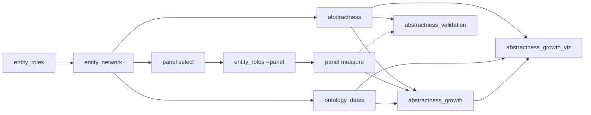

# Rebuilding

This page gets the raw object store, regenerates every derived table from it, and says what
such a rebuild reproduces. The map of commands and tables is on [Overview](overview.md).

## Getting the raw object store

Every step that re-reads files needs the object store. `retrieved_file` is stored relative
to the store root (for example `objects/61/613f4e44….rdf`), so a store captured on one
machine resolves on another. `file_hash` is the SHA-256 of the raw bytes, and
`corpus/objects.tsv` lists hash, size and path of every object the corpus references, so a
store can be checked against any tracked version of the corpus.

`ontometer-corpus store` (the `store` extra) exchanges the store with a Hugging Face dataset. The
public dataset holds the files whose declared licence allows redistribution; the others are
fetched from their sources and kept only if the bytes are unchanged:

```bash
export ONTOMETER_STORE="$HOME/ontometer-store"
ontometer-corpus store pull --store-remote hf://datasets/growgraph/ontometer-corpus
ontometer-corpus store fetch-withheld      # the rest, from canonical_url
ontometer-corpus store verify --deep       # every object present, every hash right
```

Adding to the store goes through the private working remote, never the public dataset
(`push` refuses one that holds releases). That workflow, the versioned caches and publishing a
release: [Object store](store.md).

Without a copy, the fetcher can download again from `canonical_url`, but that is a *new* capture,
against today's registries, with today's failures. Each OntoPortal instance needs its own API
key (`BIOPORTAL`, `AGROPORTAL`, `BIODIVPORTAL`, `MATPORTAL`, `ONTOPORTAL_ASTRO`,
`TECHNOPORTAL`); OKG resolution uses `GITHUB_TOKEN`.

```bash
ontometer-corpus fetch --sources lov,obo,okg,ontohub --ontoportal all
```

Rows whose `file_hash` still matches are byte-identical to the original capture; rows that
differ, or no longer resolve, are the drift.

## Rebuild commands

```bash
pip install "ontometer-corpus[build]"     # [store] to exchange the object store, [validation] for that step
```

### Stage 2: seed → parse → dedup

```bash
ontometer-corpus process                          # all three phases
ontometer-corpus process --phases parse,dedup     # a subset, in order
```

Each phase is idempotent and gated on work not yet done, so **against the committed
`corpus/corpus.db` this is a no-op**. To re-execute the logic rather than replay a stored
result, reset first.

**Full reset**: rebuild the database from the committed manifest (which is not touched).

```bash
rm "$ONTOMETER_CORPUS/corpus.db"
ontometer-corpus process
```

**Partial reset**: `--reparse` keeps the seeded rows and clears the parse and dedup results,
so every row is parsed again.

```bash
ontometer-corpus process --reparse
```

Sidecars are content-addressed and write-once: re-parsing a file whose hash already has a
sidecar skips the write (except to append the SKOS concepts an older sidecar lacks), so
`$ONTOMETER_STORE/cache/structure/` need not be cleared.

### Stage 3: network and metrics

```bash
ontometer-corpus term-coupling                       # needs the object store; writes the usage evidence
ontometer-corpus network                             # needs structural sidecars; reads namespace_usage.parquet
ontometer-corpus structural-metrics                  # needs the object store
ontometer-corpus ontology-metrics                    # joins the tables above, per ontology
```

### Stage 4: abstractness and growth



```bash
ontometer-corpus entity-roles                    # class/instance roles and labels per ontology
ontometer-corpus entity-network                  # term homes, edge authority, term-document table
ontometer-corpus abstractness                    # term and ontology abstractness
ontometer-corpus panel select       # releases of one ontology, spread over its history
ontometer-corpus entity-roles --panel            # roles for those releases
ontometer-corpus panel measure      # abstractness per release
ontometer-corpus dates                  # first-evidence dates (web archive, Wikidata)
ontometer-corpus growth --out <dir>
ontometer-corpus validation --out <dir> --concreteness <norms.tsv>
ontometer-corpus growth-viz --out <dir>
```

### Everything at once

```bash
ontometer-corpus rebuild --out <dir>                  # parse → … → G(t); parse is a no-op unless --reparse
ontometer-corpus rebuild --out <dir> --from dedup     # after a dedup or ownership change
ontometer-corpus rebuild --out <dir> --from dates     # resume after the archive throttled a run
ontometer-corpus rebuild --out <dir> --local          # no network at all: corpus dir + object store only
```

`ontometer-corpus rebuild` runs the steps above in order (`--from`/`--to` select a range, `--dry-run`
prints the commands) and never fetches. It starts with `verify`, which stops the run if an
object listed in `corpus/objects.tsv` is missing from the store, and ends with `index`, which
rewrites that list from the rebuilt `corpus.db`. `--local` runs every step in a bubblewrap sandbox
without a network, so install every extra the steps need first. Dates then come from `dating_cache.jsonl`; a lookup absent from the
cache counts as no evidence and the family's `lookups_complete` is false. A file that loads a
remote JSON-LD context cannot be read offline and is reported as a failure by the step that
reads it.

- **Population.** Exact files and explicitly identified versions are deduplicated first.
  The class/property `content_hash` is corroborating evidence, not release identity when a
  version IRI is absent. The release family is the part before
  the last `::` of a versioned fetch identifier (`bp:PTO::355` → `bp:PTO`); one latest
  representative per family is measured, while earlier releases remain available for the
  release panel. This protects submissions with no ontology IRI and conversions whose IRI
  changes between releases. Copies of one ontology from several registries keep a single
  latest row (dedup Pass D; an IRI is matched without its scheme or trailing `/` / `#`, so
  `http://schema.org/` and `https://schema.org` are one ontology, and copies declaring an
  identical class and property set are one ontology whatever their IRIs). A latest row that
  declares nothing is not an ontology (dedup Pass E). The `registry` column of
  these tables is the ontology's *home registry* (`corpus_registry.home_registry`,
  `ontometer_corpus.registries`): `OBO` for an OBO PURL, otherwise the first registry in
  `REGISTRY_PRIORITY` that holds a copy. `source_registry` only records which registry the
  kept copy was fetched from. SKOS-dominated sources (`kind` `thesaurus` or
  `mostly_skos`) are left out of the term network, so of abstractness and G(t).
- **Release panel.** `select` keeps families with at least two dated, byte-distinct releases
  and spreads the kept releases over each family's history; `measure` computes every
  release in its own hierarchy against a growth-only null model, and skips a release whose
  sidecar is missing.
- **Dates.** `ontometer-corpus dates` dates each family by its *first evidence*: the earliest of
  its registry release dates (across every registry sharing its ontology IRI), the first
  web-archive capture of that IRI, and a Wikidata inception date. Every lookup is cached in the
  tracked `dating_cache.jsonl`, so `--offline` rebuilds the same table without the network.
  The sources, rules and tables are described on [Dates](dates.md).
- **Growth.** `ontometer-corpus growth` rebuilds the specialisation network of ontologies over
  time from those dates, and writes `ontology_specialisations.parquet`, the dated ontology
  pairs. With `ontology_abstractness.parquet` and `ontology_dates.parquet`, that table is
  enough to rebuild the network over time without the object store; the documentation build
  generates the [G(t) explorer](growth.md) from those three tables
  (`ontometer_corpus.growth_network`).
- **Validation** reads WordNet through NLTK (`NLTK_DATA`) and the Brysbaert et al. (2014)
  concreteness norms from a local file. Neither is a dependency of the package; the lexical
  checks are skipped without them.

## What reproducibility means here

Three claims, worth keeping apart:

1. **The published analysis can be checked from the tracked artifacts alone.** Clone this
   repository, install the `paper` extra, and run `ontometer-corpus paper figures` against
   `data/` ([The paper](paper.md)); the G(t) explorer rebuilds from three tracked tables. Nothing external is needed. This is the
   claim that matters for checking results.
2. **The parse, network and abstractness tables are reproducible given the object store.** With
   the raw files and structural sidecars, every parse, dedup, network and abstractness step can
   be re-executed and compared; `file_hash` makes the inputs verifiable. First-evidence dates
   additionally depend on the web archive and Wikidata, whose completed lookups are tracked in
   `dating_cache.jsonl`.
3. **The capture is not reproducible.** Re-crawling produces a different corpus, because the
   registries are live services. That is a property of the subject matter, not a gap in the
   tooling.
