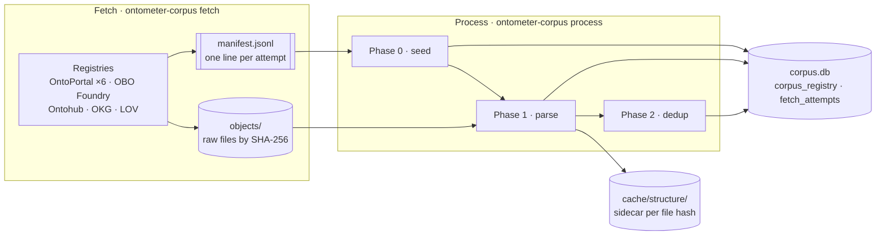

# Fetch, parse, deduplicate

This page describes the first two stages of the corpus pipeline: **fetch**, which downloads
ontology files from the registries, and **process**, which seeds, parses and deduplicates
them in three phases. Everything downstream (the dependency network, the metrics,
abstractness) reads what these stages write. The end-to-end map and the rebuild
commands are on the Overview and Rebuilding pages of the documentation; the network is
described in `ontometer_corpus/network/README.md`.

<!-- --8<-- [start:body] -->


| Step | Command | Reads | Writes | Needs the object store |
|---|---|---|---|---|
| Fetch | `ontometer-corpus fetch` | registry APIs | `objects/`, `manifest.jsonl`, `fetch_failures.log` | yes (writes it) |
| Phase 0 · seed | `ontometer-corpus process --phases seed` | `manifest.jsonl` | `corpus_registry`, `fetch_attempts` | no |
| Phase 1 · parse | `ontometer-corpus process --phases parse` | `objects/` | parse columns of `corpus_registry`, `cache/structure/` | yes |
| Phase 2 · dedup | `ontometer-corpus process --phases dedup` | `corpus_registry`, `cache/structure/` | `is_duplicate`, `canonical_entry_id`, `is_latest_version`, `shared_iri`, `dedup_exclusions.log` | yes (Pass D) |

```bash
export ONTOMETER_STORE="$HOME/ontometer-store"      # the object store; see paths below
ontometer-corpus fetch --sources lov --ontoportal BioPortal
ontometer-corpus process                     # seed, parse, dedup
ontometer-corpus process --phases parse --sequential
```

Every step is idempotent and resumes where it stopped, so running a subset of phases is a
normal operation. `ontometer-corpus process --reparse` clears the parse and dedup results first, so
every row is parsed again; seeded rows and sidecars are kept.

## Fetch

### Sources

| Source | Fetcher | History |
|---|---|---|
| OntoPortal Alliance: BioPortal, AgroPortal, BiodivPortal, MatPortal, OntoPortal-Astro, TechnoPortal | `fetchers/ontoportal.py` | every submission |
| LOV (Linked Open Vocabularies) | `fetchers/lov.py` | every dated version |
| OBO Foundry | `fetchers/obo.py` | current release |
| Ontohub | `fetchers/ontohub.py` | current file |
| Open Knowledge Graphs (OKG) | `fetchers/okg.py` | current file |

`--sources lov,obo,okg,ontohub` (or `all`) selects the non-OntoPortal sources.
`--ontoportal <name|slug|all>` selects OntoPortal instances separately. Each instance has its
own host and rate limit, so instances can run as parallel processes.

**OntoPortal: one fetcher, many instances.** The OntoPortal instances run the same REST API,
so `fetch_ontoportal(..., instance)` is parameterised by an `OntoPortalInstance(name, slug,
api_base, api_key)` rather than written once per portal. Each instance needs its own API key,
read from an environment variable (`BIOPORTAL`, `AGROPORTAL`, `BIODIVPORTAL`, `MATPORTAL`,
`ONTOPORTAL_ASTRO`, `TECHNOPORTAL`). An instance without a key is skipped. Adding an instance is
a configuration change in `ontometer-corpus fetch`. For each ontology the fetcher walks
`links.submissions`, the complete history, and keys every file on the numeric submission id
(`{slug}:{acronym}::{submissionId}`) because the free-text `version` label is not reliably
present. A full-history fetch of a large portal is long and large: try one instance first.
One instance failing never stops the others.

**LOV** walks `vocabulary/info?vocab=<prefix>` and downloads the dated `fileURL` of every
version, as `lov:<uri>::<version_label>`. OKG resolution uses `GITHUB_TOKEN`.

### Storage, manifest and resume

- **Object store.** Every downloaded file is stored once under
  `$ONTOMETER_STORE/objects/<hh>/<sha256><ext>`, keyed by the SHA-256 of its raw bytes (`file_hash`)
  and sharded by the first two hex characters. Byte-identical files from different sources
  collapse to one object. This raw-bytes hash is distinct from the entity `content_hash` that
  Phase 1 computes.
- **Manifest.** `manifest.jsonl` records every attempt, successful or not: `status`
  (`ok`/`fail`), `file_hash`, `source_version`, `content_kind`, `error`, the download URL, the
  timestamp and the registry. It is the only record of where each object came from: objects
  are named by hash and carry no source, registry or version. Never truncate or overwrite it.
  Failures are also written to `fetch_failures.log` in the corpus directory.
- **Incremental writes.** Each fetcher appends each `FetchRecord` to the manifest as soon as
  it exists (`append_record()` in `fetchers/_base.py`), so a crash loses at most the attempt in
  flight. Each append is one `write()` call, so parallel processes appending to the one
  manifest do not interleave lines on POSIX systems.
- **Resume.** A `source_id` already captured with status `ok` is skipped; failed attempts are
  retried. The resume set is read at start-up, so parallel processes each use their own
  snapshot.
- **Metadata projection.** Registry metadata is reduced to a field allowlist before it is
  stored (`ontometer_corpus/metadata.py`), and email addresses are redacted from the free text
  that is kept.

## Phase 0: seed

Seeds two tables in `corpus.db` from `manifest.jsonl`:

- `corpus_registry`: one row per **successful** fetch, keyed on `source_id`.
  `retrieved_file` points at the object, relative to the store root. Several rows may share
  one object; Phase 2 resolves that.
- `fetch_attempts`: one row per **attempt**, successful or not, keyed on
  `source_id + retrieval_date + status`. It makes each registry's capture rate queryable.

Re-seeding the same manifest never duplicates rows. After seeding, `ontometer-corpus process` prints
the capture rate per registry:

```sql
SELECT source_registry,
       SUM(status = 'ok')   AS captured,
       SUM(status = 'fail') AS failed,
       COUNT(*)             AS attempts,
       ROUND(100.0 * SUM(status = 'ok') / COUNT(*), 1) AS pct_captured
FROM fetch_attempts GROUP BY source_registry;
```

## Phase 1: parse

`ontometer_corpus/pipeline/parse.py`, entry point `run_parse`. Only rows with
`parse_status IS NULL` are parsed.

### Scheduling and memory

rdflib holds the whole graph in memory as Python objects, several times a file's
decompressed size. Compressed files can be small on disk and very large once unpacked. Parsing
is therefore scheduled and bounded:

- **Size estimate** (`estimate_real_size`). Before reading content, the decompressed size is
  estimated: the sum of member sizes for ZIP, the trailing ISIZE field for GZIP (four times
  the on-disk size when that field is implausible, as it is for concatenated streams or sizes
  over 4 GiB), and the on-disk size otherwise. Files are parsed smallest first.
- **Process pool.** `run_parse` uses a `ProcessPoolExecutor` with a capped worker count
  (`--max-workers`), recycles each worker after one file so memory cannot accumulate, and
  submits rows in chunks (`--batch-size`) so several large files do not land together.
  `--sequential` parses one file at a time in-process, which makes a hanging or
  memory-hungry file easy to isolate and stops immediately on Ctrl+C.
- **Streaming path.** Above `_STREAM_THRESHOLD_BYTES` (50 MB decompressed), a file is parsed by
  pyoxigraph instead of rdflib (`_parse_worker_streaming`); smaller files take the standard path
  below. See [Large files](#large-files).

### Large files

The streaming path reads a file triple by triple, so memory stays bounded at any size and the
counts are exact:

1. **Sniff.** The first 4 KB decide the format: content starting with `@prefix`, `PREFIX` or
   `<http(s)://` is Turtle-like, other content starting with `<` is RDF/XML, and an RSS/Atom
   feed is marked `feed`. Anything else goes to the standard path.
2. **Parse.** pyoxigraph streams the content straight from the ZIP, GZIP or plain file; the
   document is never materialised or written out decompressed.
    - Turtle-like content is read as TriG, which also accepts Turtle and N-Triples. If that
      fails, the same bytes are read again as N-Quads. Graph names are dropped.
    - RDF/XML whose XML declaration names another encoding (e.g. ISO-8859-1) is transcoded
      to UTF-8 as it streams.
    - Parsing is lenient: malformed IRIs and language tags are kept rather than rejected.
3. **Extract.** Each triple becomes one N-Triples line, and `_stream_parse_ntriples_like` reads
   those lines to produce the same metadata and sidecar as the standard path.

The outcome is `ok` with `parse_format` `stream_nt_cvt` (Turtle-like) or `stream_xml_cvt`
(RDF/XML); `fail` with the parser's message when every format is rejected; or `unsupported`
for well-formed content without a triple. A large file with no OWL schema (a SKOS or
instance dump) is a valid result with zero classes. The streaming path needs no system
tools: pyoxigraph is part of the `corpus` extra.

### Standard path

Each file is read from disk once and reused for every step:

1. **Decompression.** ZIP, GZIP and BZIP2 archives are extracted to a temporary file in a
   disk-backed scratch directory next to the store (`<ONTOMETER_STORE>/../_parse_scratch`), not
   the system temp directory, which is often RAM-backed. The file is removed in a `finally`
   block, so any exception still cleans up, and an unexpected exception becomes a `fail` row
   rather than aborting the batch.
2. **Early exclusion.** RSS/Atom feeds are marked `parse_status = 'feed'` and
   Manchester/Functional OWL syntax `'unsupported'`, before any RDF parser runs.
3. **rdflib.** The format is guessed from the content, so the common case needs one attempt;
   otherwise every format is tried. If all fail, regex repairs for common syntax errors
   (invalid language tags, unbracketed Turtle prefixes, punctuation typos, stray spaces in
   prefixes) are applied and parsing is retried once.
4. **Offline parsers.** A line-based OBO parser and an `ElementTree` OWL/XML parser, used when
   the content is recognised as one of those formats and rdflib did not succeed.
5. **owlready2**, as the last resort, with imports stripped so it never makes network requests.
6. **Imports.** `owl:imports` IRIs are extracted from the raw file by pattern, independently of
   which parser succeeded.

### What parsing writes

- **Row metadata** in `corpus_registry`: triple, class, property and individual counts; the
  ontology IRI, version IRI and version info; imports; `content_hash`; and `parse_format`, the
  path that produced the result (`xml`, `turtle`, …, `obo`, `owl_xml`, `owlready2`, or
  `stream_xml_cvt`/`stream_nt_cvt` for the streaming path).
- **Individuals**: `individual_count` is every named subject declared `owl:NamedIndividual`
  or typed by a domain type (outside the modelling-language namespaces of
  `ontometer_corpus.roles`, or `owl:Thing`), minus declared classes, properties and the ontology
  header. SKOS concepts count. Its subsets `declared_individual_count` (declarations only) and
  `skos_concept_count` (typed `skos:Concept`) are stored beside it. In OWL/XML every
  individual reference is a `NamedIndividual` element, so there the declared and full counts
  agree; OBO counts `[Instance]` stanzas.
- **Kind**: `kind`, a generated column computed from the class and SKOS concept counts:
  `no_skos`, `thesaurus` (SKOS concepts, no classes), `mostly_skos` (at least as many concepts
  as classes) or `mostly_owl`. The first two SKOS kinds are SKOS-dominated
  (`ontometer_corpus.role_names.SKOS_DOMINATED_KINDS`): they stay in the corpus inventory and the
  dependency network, and are excluded from the hierarchy-based analyses (term network, G(t),
  structural metrics, clustering), which assume an OWL class hierarchy.
- **Namespace footprint** for the dependency network: `referenced_namespaces`, the namespaces
  of every IRI used as subject, predicate or object; and `own_namespaces`, the namespaces of the
  ontology's own declared entities plus its ontology IRI. A referenced namespace that is not
  one of its own is an external dependency.
- **Licence**: `licence`, the raw licence and rights statements the file makes about itself
  (`dcterms:license`, `dcterms:rights`, `dc:rights`, `cc:license`, `schema:license`,
  `xhv:license` on its `owl:Ontology` or `skos:ConceptScheme` header, or the matching OBO header
  and OWL/XML annotations), as a JSON list: `[]` when it declares none, NULL for a row parsed
  before the column existed. `ontometer-corpus store licenses` normalises them.
- **Structural sidecar**: one Parquet file per raw-byte `file_hash` under
  `$ONTOMETER_STORE/cache/structure/v<N>/<hh>/<file_hash>.parquet`, holding `subclass_edges`
  (child → parent), declared `entities` (`iri`, `kind`), and the IRIs directly typed as
  `skos:Concept`. The latter lets namespace ownership count concepts inside the namespace being
  resolved, including for files too large for the optional role pass. Sidecars are write-once: a
  file whose hash already has a sidecar skips the write, except that a reparse can append this
  SKOS marker to a sidecar written by an older pipeline version.
  When the sidecar content changes, bump `STRUCTURE_VERSION` in `ontometer_corpus/paths.py`:
  the next parse writes into an empty `v<N+1>/` and the old version is ignored
  (`ROLES_VERSION` does the same for `cache/roles/`).

### Identity and counting rules

- **Ontology IRI and its fallback.** `ontology_iri` is the subject of the file's
  `owl:Ontology` declaration. Many older RDF/RDFS vocabularies make no such declaration.
  Without an IRI a row enters the network as an anonymous `row:<id>` node that nothing can
  reference, which would zero its in-degree. Where the registry's `source_id` carries the IRI
  (LOV's does, as `lov:<uri>::<version>`), it is used instead. `iri_source` records which:
  `declared`, `registry`, or NULL for parser paths that do not report it.
- **Properties.** `property_count` counts `rdf:Property` as well as the OWL property types,
  just as `class_count` counts `rdfs:Class` as well as `owl:Class`, so pre-OWL vocabularies
  report their properties.
- **`content_hash` and the counters share one entity set.** `content_hash` is the SHA-256 of
  the sorted class and property IRIs, computed from the same `_CLASS_TYPES` /
  `_PROPERTY_TYPES` constants as the counters. Phase 2's Pass B uses a non-zero count as
  evidence that a row contributed IRIs to its hash. A row with none hashes to `SHA-256("")`,
  which every entity-less file shares, so grouping on it would merge unrelated files. Pass B
  also rejects the empty hash directly.
- `parse_error` is truncated to 2,000 characters, since some parser errors echo the input.

## Phase 2: dedup

`ontometer_corpus/pipeline/dedup.py`. Distinct versions of one ontology stay separate
canonical rows; only copies of the *same* version, fetched from several registries or URLs,
collapse. Dedup flags are derived state and are reset at the start of the phase, so rerunning
it applies the current rules and can restore a row classified by an older rule. Each pass then
considers only rows not marked by an earlier pass in that run.

1. **Pass 0, exact bytes.** Rows with `parse_status = 'ok'` grouped by `file_hash`.
   Byte-identical files collapse unconditionally.
2. **Pass A, IRI and version.** Rows grouped by `(ontology_iri, ontology_version_iri)`. The
   same IRI with a different version IRI is a different version. Rows with no version IRI are
   preserved: the IRI and a stable class/property set do not establish release identity.
3. **Pass B, corroborated content.** Rows are compared by `content_hash`, but collapse only
   when they also share the same non-null `ontology_version_iri`. An unversioned hash match is
   evidence of a stable vocabulary signature, not proof of an identical release.
4. **Pass C, latest per release family.** Among the canonical rows of each release family
   (the fetch identifier before its last `::`: `bp:PTO::355` → `bp:PTO`), the newest by
   `source_version_date`, then submission number, is flagged `is_latest_version = 1`.
   Version labels such as `v0.99` and `v2005-04-03` do not sort chronologically, so dates are
   used. A single snapshot is its own latest.
5. **Pass D, one latest row per ontology.** Release families are per registry, so the
   same ontology mirrored by several registries (RO from AgroPortal, BioPortal and OKG, each a
   different release) has several latest rows after Pass C. Two latest rows are one ontology
   when either holds:
   - **IRI and terms.** They declare the same ontology IRI, matched by `ontology_key`: scheme
     and trailing `/` or `#` ignored, and an OBO build artifact read as its ontology's PURL
     (`.../obo/pco/pco-full.owl`, `.../obo/oba/oba-base.owl`, `.../obo/go/extensions/go-plus.owl`
     → `.../obo/<id>.owl`). Their declared terms (structural sidecars, compared without scheme
     and with `#` read as `/`) must overlap. Across registries, at least half of the smaller
     copy's terms are in the larger, since a registry often holds an older, smaller release.
     Within one registry, which lists the two as separate entries, the overlap is taken over
     their union (Jaccard index at least one half), so a module or extract published under
     its parent's IRI stays its own ontology. Two releases under the ontology's own OBO PURL
     that share a term are one ontology, and a copy declaring nothing joins the largest.
   - **Identical terms.** One of them, or an earlier canonical release of its family,
     declares exactly the class and property set (`content_hash`) of the other or of one of
     its family's releases. This needs no IRI, so it links copies whose file declares none
     and copies of an old release whose family later renamed every term. Under two different
     IRIs the set must hold at least `MIN_IDENTICAL_TERMS` terms, since a project's modules
     can declare the same few metadata terms.

   Sidecars and content hashes record no SKOS concepts, so copies carrying concepts must also
   have comparable concept counts (the smaller at least half the larger): AGROVOC, ASFA and
   the AGROVOC schema declare the same properties under one IRI and stay distinct. Of each
   group only the newest stays latest: the date in its version IRI, else the registry's
   release date; dated before undated; then the curating registry (OBO for OBO PURLs, else
   LOV); then the most declared entities. When an IRI covers several *distinct* ontologies
   (the crop ontologies declaring `https://cropontology.org/rdf/`, placeholders such as
   `.../obo/TEMP.owl`), every row with it gets `shared_iri = 1`: the IRI identifies none of
   them, and network nodes use `row:<id>` instead. The IRI evidence reads the sidecars, so
   Pass D needs `--store`; without it, it is skipped with a warning.
6. **Pass E, an ontology declares something.** A latest row declaring no class, property,
   individual or SKOS concept (an import-only aggregator, an empty submission, a failed
   conversion) loses `is_latest_version` and is listed in `dedup_exclusions.log`: it is a
   pointer, not an ontology.

In each group the canonical row is the one with the most triples, then the earliest
retrieval, then the lowest row id; no registry is treated as more authoritative. Duplicates
get `is_duplicate = 1` and point at their canonical row through `canonical_entry_id`. Rows
that Pass B leaves out because they declare no classes or properties, and rows Pass E
unflags, are listed in `dedup_exclusions.log`.

**Choosing rows.** `WHERE is_latest_version = 1` gives the newest canonical version of each
ontology, once across registries, and implies `parse_status = 'ok'` and `is_duplicate = 0`.
`WHERE is_duplicate = 0` keeps the full version history.

Registries that number submissions without an ontology IRI are not linked by the IRI-based
passes, so each submission can remain its own "latest". The abstractness stage therefore
groups rows into *release families* from their fetch identifiers
(`ontometer_corpus/versions.py`); see the Abstractness page of the documentation.

## Downstream

The dependency network (nodes are the latest canonical ontologies; edges are `owl:imports`
and namespace usage) is built from `corpus.db` and the sidecars, with no further parsing; see
`ontometer_corpus/network/README.md`.

<!-- --8<-- [end:body] -->
